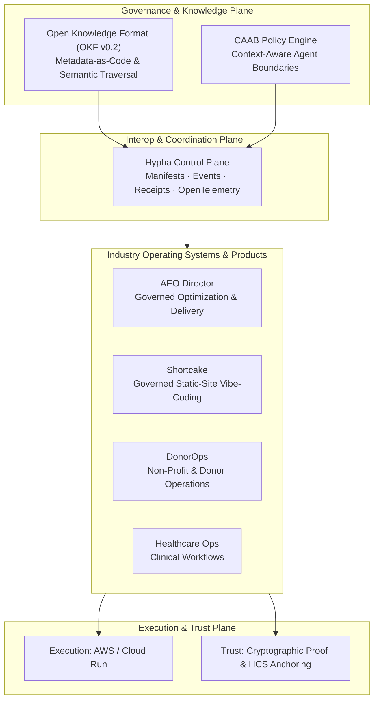

# WUN AI

> **Run important work more reliably.**  
> WUN builds secure, industry-specific operating systems that help teams execute high-value workflows with greater clarity, capacity, and control.

🌐 **Website:** [wun.ai](https://www.wun.ai) &nbsp;|&nbsp; 📖 **Knowledge Base:** [OKF Catalog](https://github.com/wun-ai/wun-ecosystem) &nbsp;|&nbsp; ⚡ **Control Plane:** [Hypha](https://github.com/wun-ai/hypha)

---

## What is an Industry-Specific Operating System?

An industry-specific operating system is the complete operating structure for a high-value domain function: its records, workflows, decision rules, autonomous agents, permission boundaries, human checkpoints, and verifiable accountability.

Rather than generic chat interfaces or unconstrained automations, WUN pairs domain-specific data models with **bounded agents** that operate under explicit policy guardrails.

---

## Core Architecture & Foundations

### 1. [Hypha](https://github.com/wun-ai/hypha) — Interoperability Control Plane
A lightweight interop control plane that enables workflows and autonomous agents to call, extend, and exchange scoped data across tool and ownership boundaries without forcing teams to adopt a single monolithic engine.
* **Separation of Planes:** Decouples execution (AWS), trust/ordering (Hedera HCS anchoring), and observability (OpenTelemetry).
* **Cryptographic Receipts:** Tamper-evident completion receipts and scoped payload references keep custody inside operator enclaves.

### 2. Bounded Agents & CAAB (Context-Aware Agent Boundaries)
* **Least-Privilege Containment:** Agents run within explicit permission cones and strict execution budgets.
* **Human-in-the-Loop:** Irreversible and customer-facing mutations require verified review checkpoints.

### 3. Open Knowledge Format (OKF v0.2)
* Built upon Google's [Open Knowledge Format](https://github.com/GoogleCloudPlatform/open-knowledge-format) standard.
* Treats context, operational runbooks, and system architecture as version-controlled Markdown with structured YAML frontmatter, enabling deterministic semantic traversal for both humans and AI systems.

---

## Ecosystem Repositories

| Repository / Product | Role | Source / Status |
|---|---|---|
| [**`hypha`**](https://github.com/wun-ai/hypha) | Lightweight interoperability control plane for agentic workflows | GitHub (Active) |
| [**`wun-ecosystem`**](https://github.com/wun-ai/wun-ecosystem) | Version-controlled OKF v0.2 knowledge base, research records, and ADRs | GitHub (Active) |
| [**`aeo-director`**](https://aeod.wun.ai) | Governed content-intelligence & Answer Engine Optimization (AEO) platform | GitLab (Active) |
| [**`donorops`**](https://gitlab.com/violetek/donorops) | Governed donor-operations operating system & clean-room V2 platform | GitLab (Active) |
| [**`shortcake`**](https://getshortcake.com) | Governed static-site vibe-coding control plane & FastMCP server | GitLab / Netlify (Active) |
| [**`.github`**](https://github.com/wun-ai/.github) | Organization profile, community health standards, and shared workflows | GitHub (Public) |

---

## Guiding Principles

1. **Protocol First:** Clean schemas, capability manifests, and event contracts precede concrete runtimes.
2. **Operator-Controlled Custody:** Payloads remain in tenant enclaves; only scoped references and hashes cross trust boundaries.
3. **Evidence-Gated Viability:** High-confidence claims require reproducible empirical validation, not architecture diagrams alone.
4. **Governed Delivery:** Automated systems suggest and verify; human operators retain final release authority.

---

  © WUN.ai — Designed for trust, precision, and reliable autonomous operations.

